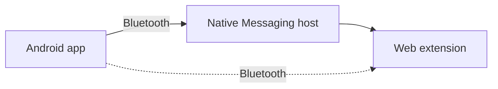

## The Android app

Veles is a single-module Android app. It listens for notifications, tries a chain of handlers and, when one accepts the message, replaces the original notification with a short one.

- `NotificationListener` is a `NotificationListenerService`.
- `CompositeMessageHandler` tries each handler in turn. If a handler returns `ACCEPTED`, the original notification is cancelled and the chain stops; otherwise the result is `FILTERED` and the next handler is tried.
- Each bank is a row in the local Room database (`bank_handler_configs`) with three regular expressions: `otpRegex` (code), `moneyRegex` (currency and amount) and `merchantRegex` (merchant). All three must match for a message to be accepted.
- `UserNotifierOtpMessageHandler` posts the concise notification, and `CopyDataReceiver` copies the code to the clipboard when you tap Copy.

## External devices (in development)

Sharing codes with a computer over Bluetooth is still in development. The design is described in the external-devices RFC and the protocol contract in `protocol/`.

- The phone is paired once with a computer using a six-digit code and a SPAKE2 exchange.
- The web extension is the connector in the browser. The native host is a plain Rust program that Chrome launches to relay Bluetooth scan, connect and send requests to the phone.
- The shared Rust crypto core in `rust/` is compiled for Android and for the browser, so both ends use the same code.
- The wire format is defined once in `protocol/` and checked against all consumers.

See the Specifications group for the detailed rules of each part, and the RFC under Engineering reference for the history of the design.
